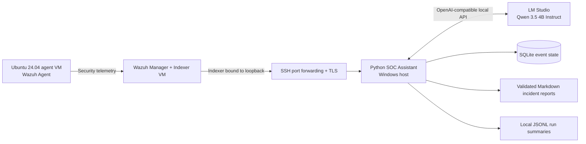
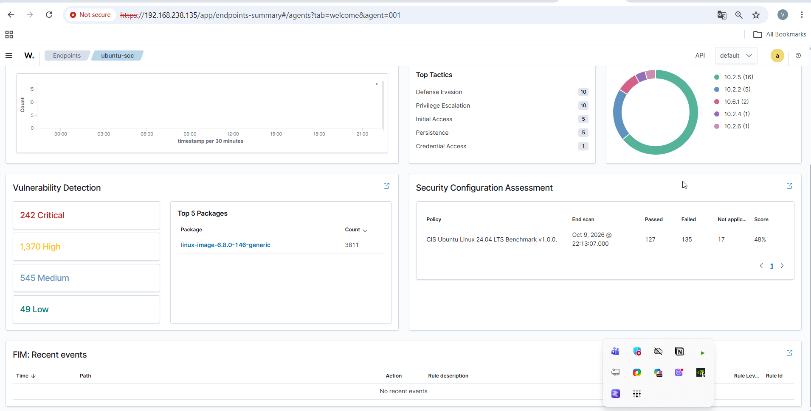
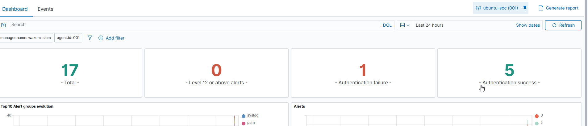
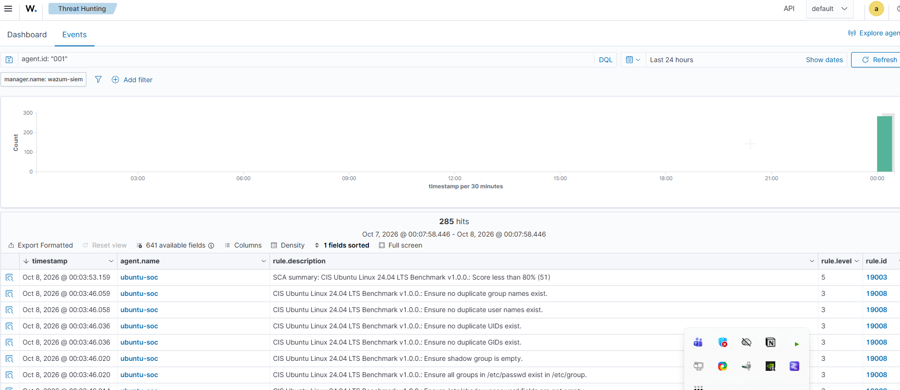
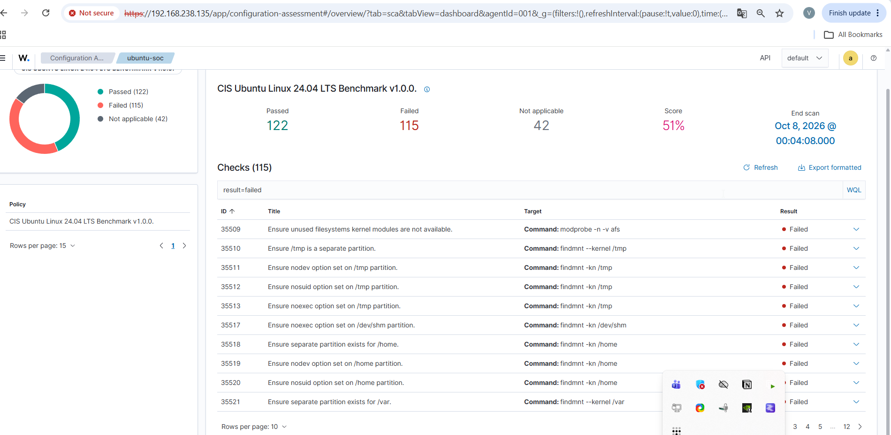
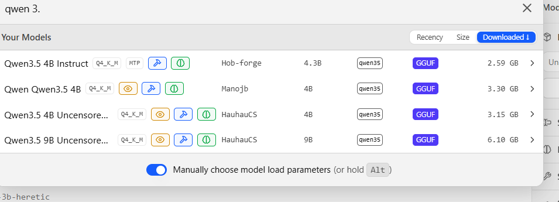
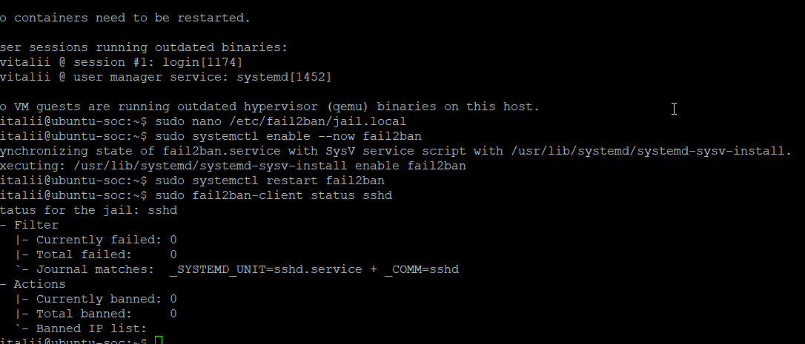
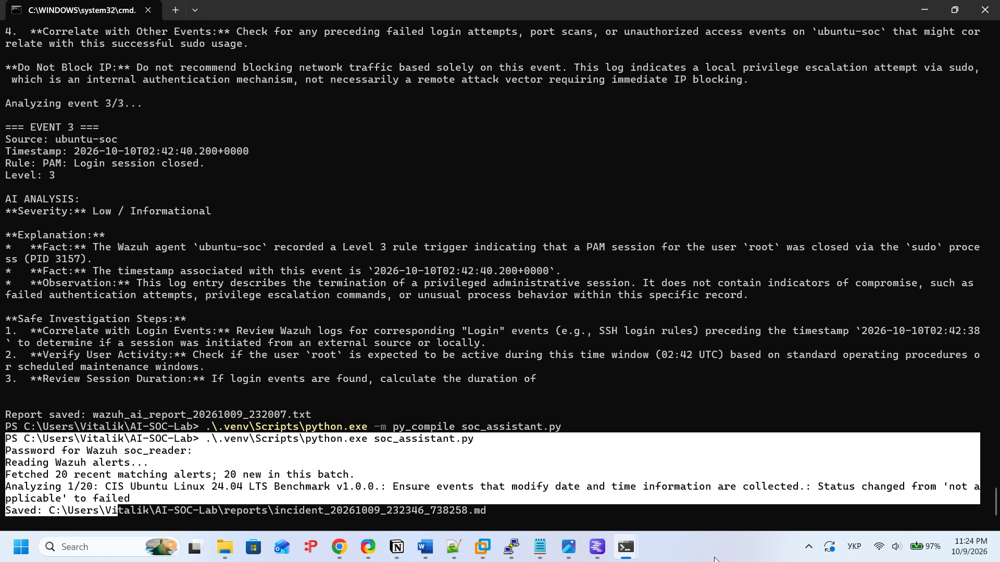
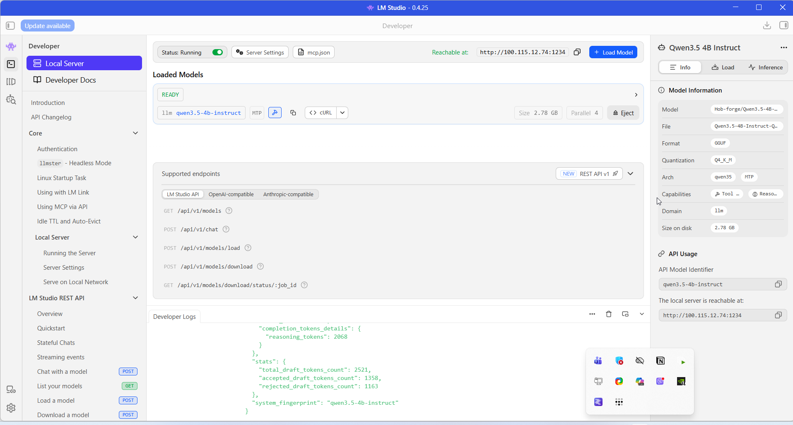

# AI-Powered SOC Lab

**Wazuh SIEM · OpenSearch · Python · SQLite · Local Qwen (LM Studio)**

A hands-on defensive Security Operations Center (SOC) proof of concept. I built and tested a pipeline that retrieves Wazuh alerts over an SSH tunnel, sends selected events to a locally hosted LLM for structured triage, validates its responses, and saves incident notes for analyst review. **The model cannot execute remediation commands.**

> **Scope:** Isolated/authorized lab, manually operated. This is **not** a production SOC, fully autonomous response system, or continuous alert monitor.

## Architecture



Indexer port 9200 is bound to server loopback. The Windows Python client verifies the Indexer certificate using a local CA file and authenticates with a restricted `soc_reader` account.

## Demonstrated results

| Capability | Evidence |
| --- | --- |
| Paginated retrieval | 152 matching Wazuh alerts fetched, **152 unique IDs**, verified against a matching count snapshot |
| Durable state | 20 existing processed IDs migrated to SQLite; integrity check `ok` |
| Report restoration | 1 synthetic report successfully recovered from a temporary test database |
| Local LLM triage | Qwen 3.5 4B produced a schema-validated report for a synthetic failed SSH login |
| Input hardening | One synthetic prompt-injection retest did not cause the LLM to misreport the failed login |
| Automated tests | **31 mocked/offline tests** passed on Python 3.10 and 3.12 in GitHub Actions |
| Secrets and privacy | History scan: two generic-key findings identified as the same benign JSON example in two commits; screenshots replaced with redacted versions in current branch history |

A passing test does not prove production reliability, complete prompt-injection resistance, or the accuracy of model hypotheses.

## What the system does

1. **Collect** Linux security events through Wazuh Agent and Manager.
2. **Fetch** matching alerts from the OpenSearch Indexer using paginated Scroll over an SSH tunnel.
3. **Deduplicate** events against a SQLite event ledger. Existing IDs from `processed_events.json` migrate without deleting the original.
4. **Analyze** at most **5 new alerts per manual run by default** (`SOC_MAX_EVENTS`, range 1–20). The model is pinned to an explicit `SOC_MODEL_ID`.
5. **Validate** Qwen's JSON output (schema fields, completion status, basic factual anchors, and a conservative filter for mutating recommendations).
6. **Persist** report content in SQLite before exporting Markdown; keep aggregate local run summaries at `logs/soc_runs.jsonl`.

No automatic firewall blocking, system modification or external incident response is performed.

## Reproduce the offline test suite

Requires Python 3.10+; the isolated tests do **not** require VMware, Wazuh, SSH credentials or LM Studio.

```powershell
py -m venv .venv
.\.venv\Scripts\python.exe -m pip install -r requirements.txt
.\.venv\Scripts\python.exe -m unittest discover -s tests -v
```

GitHub Actions runs the same tests on pull requests and pushes to `main`, with Python 3.10 and 3.12. See [CI setup](docs/GITHUB_CI.md).

## Manual lab operation

See [Ukrainian setup guide](docs/SETUP_UK.md), [security notes](docs/SECURITY.md), [pagination](docs/INGESTION_PAGINATION.md), [SQLite migration](docs/SQLITE_MIGRATION.md), and [model validation](docs/QWEN_OUTPUT_CONTRACT.md). The lab requires a running Wazuh Indexer, a verified SSH tunnel, an authenticated read-only Indexer user, trusted `root-ca.pem`, and a loaded LM Studio model.

Example environment settings in a PowerShell session:

```powershell
$env:SOC_MODEL_ID = "qwen3.5-4b-instruct"
$env:SOC_MAX_EVENTS = "5"
.\.venv\Scripts\python.exe soc_assistant.py
```

The assistant prompts interactively for the Indexer reader password. **Do not schedule the script unattended** without a separate secure credential design. Qwen thinking was disabled in LM Studio for the verified synthetic JSON test.

## Engineering lessons: audit → fix → verify

The repository includes [Claude and Kimi audit material](audits/README.md). The audits guided engineering work; recommendations were treated as **hypotheses**, not automatically as verified vulnerabilities. The Claude audit had limited source visibility and should not be interpreted as a complete code review.

- **Alert loss window:** replaced latest-20-only retrieval with Scroll pagination; verified 152/152 matching alerts.
- **Crash recovery:** introduced SQLite event state, replayable report exports and retryable errors.
- **LLM output quality:** enforced a strict JSON contract and explicit model selection; rejected truncated outputs.
- **Untrusted logs:** bounded log inputs and checked selected factual claims. A live synthetic test revealed a firewall-block recommendation, motivating an additional read-only recommendation filter.
- **Engineering quality:** added bounded runs, structured summary logging and GitHub CI; CI caught a real regex escaping bug that local tests had not revealed.

[Detailed engineering case study](docs/PORTFOLIO_CASE_STUDY.md) · [Sanitized example incident report](examples/ssh-incident-report.md)

## Security boundaries and known limitations

- The public repo must not include real passwords, private SSH keys, local SQLite databases, unredacted real logs, or raw incident reports.
- **LM Studio network access remains enabled for a separate Hermes chatbot**, with `0.0.0.0:1234` observed in the local lab. Firewall reachability/source restrictions have **not** been verified; this is an open risk.
- Although current screenshots were replaced with cleaner copies, older versions remain in Git history. Review history before sharing widely.
- One synthetic prompt-injection success is **not comprehensive** security assurance. The model may hallucinate attack patterns or misstate evidence; all reports require human review.
- Scroll is a snapshot read, not continuous ingestion or durable time checkpointing. Runs remain manually initiated.
- Windows file permissions, TLS, SSH and user roles received targeted checks; they are not a complete penetration test or proof of all effective rights.

## Repository map

| Path | Purpose |
| --- | --- |
| `soc_assistant.py` | Wazuh ingestion, LLM analysis and manual workflow |
| `event_store.py` | SQLite persistence and report restoration |
| `analysis_contract.py` | Structured output parsing and validation |
| `log_guardrails.py` | Untrusted field bounding and basic grounding |
| `run_journal.py` | Local structured run summaries |
| `tests/` | Offline unit tests |
| `docs/` | Setup, integration tests, security and case study |
| `audits/` | Public AI-assisted audit material |
| `screenshots/` | Redacted portfolio screenshots |

## Project Screenshots

### Wazuh Endpoint Monitoring


### Threat Hunting


### Security Events


### Security Configuration Assessment


### Local Qwen Model


### Wazuh Agent Status


### Python AI SOC Assistant


### LM Studio Local API Server



**For employers:** This project demonstrates practical Linux administration, Wazuh/OpenSearch investigation, SSH/TLS integration, Python reliability engineering, local LLM integration and disciplined validation—not autonomous security decision-making.
